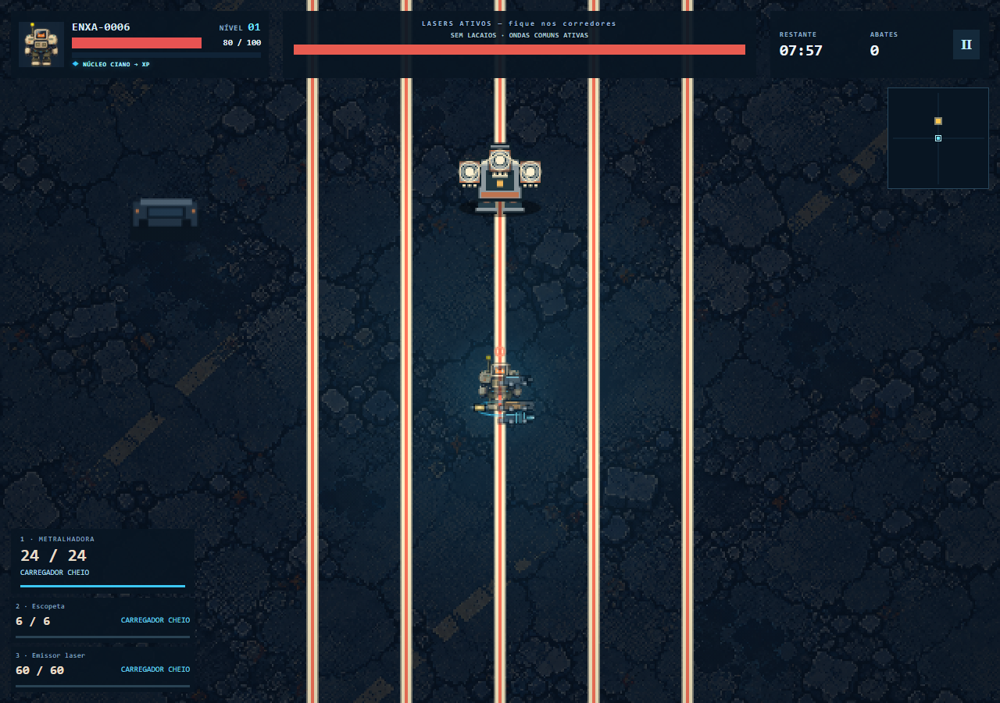

# Screwvivors — BUILD 70 · desenvolvimento

Gambiarras do Biruta agora aparecem somente no nível20 e combinam robô e armas numa única instalação. Os antigos bônus3/6/9, a oferta do nível10 e os experimentos instáveis foram removidos. [Regras e testes](docs/gambiarras-nivel20.md).

Sobreviva por 20 minutos numa cidade industrial, pilote um robô com seu gato e transforme sucata em uma build de combate. Jogo 2D para navegador, com mira e disparo manuais, feito em HTML, CSS e JavaScript.

**[Baixar o jogo — BUILD70](https://github.com/vbg16/robots-zombies/releases/tag/build70-dev)** · **[Documentação](docs/README.md)** · **[Reportar problema](https://github.com/vbg16/robots-zombies/issues/new/choose)**

> Versão de desenvolvimento. A meta de conclusão, o balanceamento final e a aprovação do canal público continuam abertos. [O que já foi verificado e suas limitações](docs/build68-verificacao.md).

*Captura de um cenário controlado de verificação da BUILD68. Não representa uma partida natural ou medição de desempenho.*

## Jogar

1. Abra a [release BUILD70](https://github.com/vbg16/robots-zombies/releases/tag/build70-dev) e baixe **Screwvivors-BUILD70-jogo.zip**.
2. Extraia o ZIP inteiro para uma pasta nova.
3. Abra **index.html** no navegador. O jogo e o editor funcionam offline.
4. Na garagem, escolha o chassi e as armas; depois use **Configurar incursão → Iniciar incursão**.

No celular, jogue **na horizontal** com os dois direcionais de toque. Girar para retrato pausa; voltar para horizontal exige continuar manualmente. O áudio começa após um gesto; há controles separados de música e efeitos.

Para baixar também código, testes e evidências, use **Code → Download ZIP** na `main`. O [ZIP legado em downloads](downloads/historico/README.md) é histórico e não contém as modificações atuais. Uma cópia antiga já baixada não se atualiza sozinha.

## Controles no PC

| Ação | Controle |
|---|---|
| Mover | WASD ou setas |
| Mirar | Mouse |
| Atirar | Segurar botão esquerdo |
| Recarregar o conjunto | R; também ocorre ao esvaziar |
| Pausar / continuar | P ou Esc |
| Propulsor adquirido | Espaço, após obter a melhoria |
| Analisar aprimoramento | Clique ou teclas 1–3 |
| Instalar a opção analisada | Botão ou Enter |

## Correção da BUILD70

Zumbis vivos agora têm separação física pelo raio do corpo, além do comportamento de bando. Isso evita filas sobrepostas, inclusive entre corredores, lacaios e policiais. [Regras e verificação](docs/colisao-zumbis.md).

## Base de jogo preservada

- Partidas com contador **20:00 → 00:00** e arena sem bordas.
- **Seis chassis**, **doze armas**, dez guias de build e 24 reforjas de arma.
- **56 módulos normais**, 23 peças raras de chefe e 86 aprimoramentos editáveis; 109 artigos no compêndio.
- Especialização do robô no nível 10 e reforja da arma no nível 20, sem trocar ou fundir o equipamento durante a tentativa.
- Zumbis surgindo fora da tela, diretor procedural e preferência por bandos. Cada instalação válida afasta inimigos próximos em 120 pixels.
- Prisma de Cerco com agenda aos **12 minutos decorridos (08:00 restantes)**. Se outro chefe ainda estiver vivo, aguarda; ondas comuns continuam.
- Melhorias temporárias durante a tentativa. Parafusos e peças de fabricação coletados persistem após morrer; a garagem desbloqueia equipamentos.
- Trilha synthwave suave, sons, animações e controles por toque independentes.

[Contrato atual](docs/contrato-atual.md) · [Regras da incursão](docs/incursao-vinte-minutos.md) · [Histórico de versões](CHANGELOG.md).

## Configurar as skills

Abra **CONFIGURAR SKILLS** no menu ou **painel-skills.html**. O painel usa o catálogo real do jogo, permite editar ganhos/custos, criar módulos normais e importar/exportar JSON.

As alterações ficam em rascunho até **Aplicar ao jogo** e valem para as próximas tentativas. Multiplicar por **1,1** aumenta um atributo em 10%; **+10** soma dez unidades. As configurações ficam neste navegador e origem; exporte o JSON para transferi-las. Seu progresso de garagem é separado do balanceamento.

[Detalhes do editor](tools/skills-panel/README.md).

## Desenvolvimento e documentação

| Preciso de… | Onde encontrar |
|---|---|
| Regras atuais | [Contrato vigente](docs/contrato-atual.md) |
| Instruções para reconstruir o jogo e 487 casos de aceite | [Especificação mestre](docs/SCREWVIVORS-ESPECIFICACAO-E-TESTES.md) |
| Critérios para encerrar o projeto | [Meta de conclusão](docs/META-DE-CONCLUSAO.md) |
| Resultados da versão atual | [Verificação BUILD68](docs/build68-verificacao.md) |
| Como executar testes e empacotar | [Contribuir](CONTRIBUTING.md) |
| Onde fica cada parte do projeto | [Mapa do repositório](docs/estrutura-do-repositorio.md) |
| Métodos e controles do bot | [Bot de testes](docs/bot-de-testes.md) |
| Checagens automáticas | [GitHub Actions](https://github.com/vbg16/robots-zombies/actions/workflows/verify.yml) |

O jogo não exige instalação de pacotes ou servidor. Para trabalhar com servidor local, execute `python -m http.server 8000 --bind 127.0.0.1` e abra <http://127.0.0.1:8000/>.

## Canais do projeto

| Branch | Uso |
|---|---|
| `main` | Desenvolvimento enviado; origem do download padrão do código. |
| `codex/desenvolvimento` | Mesmo commit verificado da `main` nas entregas coordenadas. |
| `codex/publico` | Candidata histórica separada, ainda sem promoção aprovada. |

Releases de desenvolvimento são **pré-lançamentos** e identificam o commit do jogo distribuído. CI aprovado não significa jogo concluído nem promoção automática do público. [Regras de canais e publicação](docs/canais-e-lancamentos.md).
