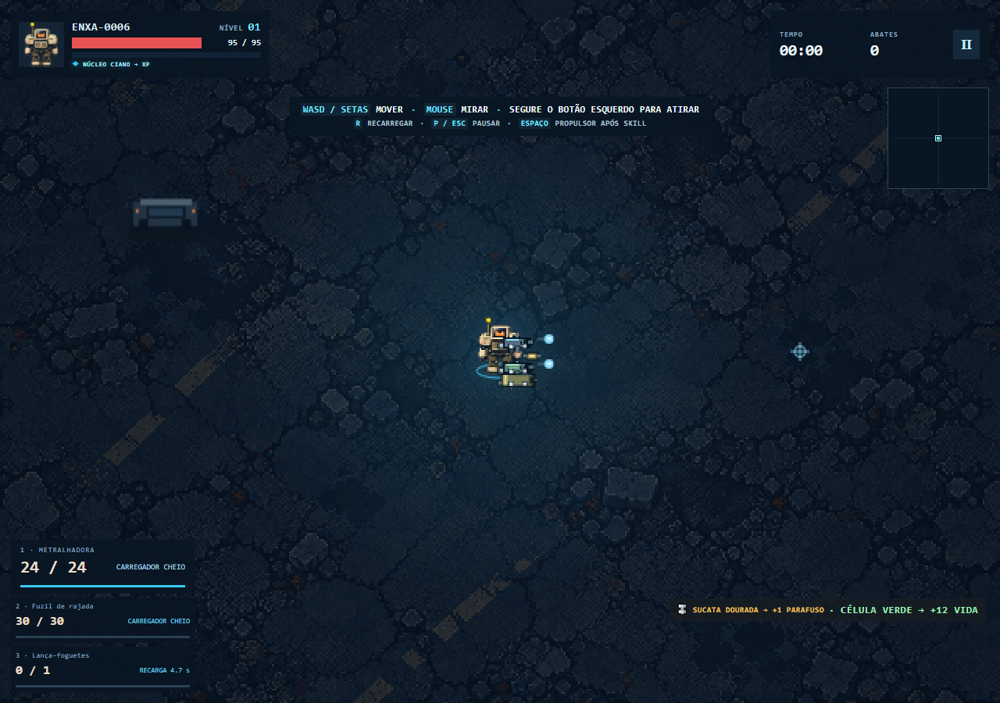
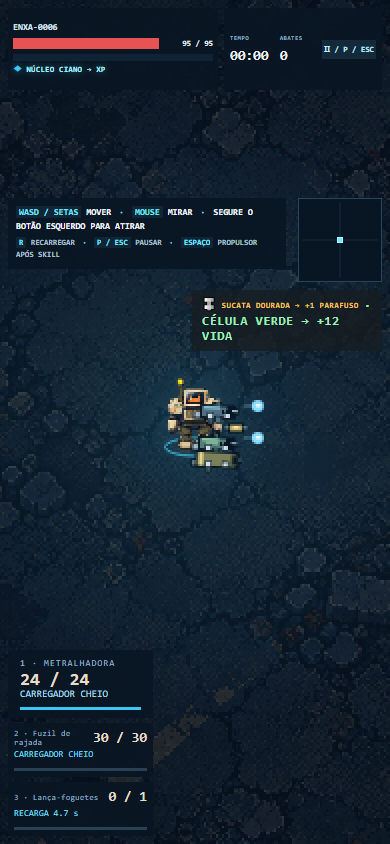

# Arsenal avançado — BUILD51

BAST-0002 pode equipar duas armas; ENXA-0006, três. Os demais chassis mantêm uma. Armas adicionais são opcionais, distintas e precisam estar desbloqueadas. As escolhas aparecem na garagem com atributos, reforjas futuras e os custos do conjunto, antes da configuração da incursão.

| Quantidade equipada | Dano de cada arma | Movimento | Cura de recarga por arma |
|---:|---:|---:|---:|
| 1 | 100% | 100% | 100% do valor proporcional |
| 2 | 70% | 90% | 50% do valor proporcional |
| 3 | 55% | 80% | 33,33% do valor proporcional |

Uma arma continua com os atributos anteriores nos seis chassis. Os espaços adicionais não acrescentam vida, armadura ou dano permanente. A quantidade efetivamente equipada determina os custos; selecionar ENXA com uma arma não aplica o custo de três.

## Regras de combate

Todas as armas seguem a mesma mira e o mesmo botão manual. Cada uma mantém carregador, recarga, rajada, cadência, contagem do quinto disparo, recuo e reforja próprios. R inicia as recargas necessárias; uma recarga terminada não conclui as demais. Soltar ou cancelar o ponteiro apaga imediatamente todas as rajadas pendentes. Não há troca ou fusão de armas em campo.

No nível20, a oferta passa por cada arma, uma após outra, com o jogo pausado. Escolher ou recusar afeta somente aquela arma; recusar não devolve a oferta. A sequência não repõe munição, termina recargas ou altera projéteis em voo. Callbacks de uma oferta antiga são recusados na próxima. Reiniciar descarta todas as reforjas.

Módulos aplicam seus modificadores de arma a cada base, incluindo operações aditivas editadas no painel. Efeitos compartilhados de vida, movimento e suportes executam uma vez. Cura de recarga é dividida por quantidade equipada. Drones, sensores e rotores usam a principal; não somam as bases de todo o arsenal.

Projéteis capturam a arma, os traços de reforja e o dano direto da origem. Reposições por abate/eletricidade devolvem uma munição à arma responsável. Queimadura guarda a origem do DPS dominante; uma queimadura posterior mais fraca não rouba essa origem. Corrosão e respingos guardam origem escalar, sem reter o grafo de projéteis/inimigos. Efeitos sem arma usam a principal. Escudos policiais conservam100pontos e absorvem integralmente o golpe de quebra.

O limite existente de400projéteis é compartilhado. A prioridade de emissão gira entre as armas, para que uma salva grande não reserve sempre o primeiro atendimento. Esse orçamento não limita inimigos vivos. Partidas mantêm ondas15, arena sem bordas, chefes recorrentes, empurrão e progresso temporário.

## Evidência automatizada

- `tests/advanced-loadout.cjs`: posse/capacidade/duplicatas, normalização no reset, custos, equipamento fixo, estados independentes, cura compartilhada, dano e reposição na origem, queimadura/corrosão, snapshots, reforjas20, callbacks antigos, pausa/reset e orçamento rotativo.
- `tests/weapon-state-balance.cjs`:82 entradas, campos compartilhados preservados, módulos reais, reforja local, soma editada e limites numéricos.
- `tests/arsenal-matrix.cjs`:132pares e1320trios ordenados das12armas. Cada arma emitiu com estado finito e orçamento compartilhado. São apenas0,6s por caso com módulos explícitos e alvos estacionários; não cobrem todas as situações de uma partida.
-48mundos de uma arma continuam exatamente iguais à BUILD50, incluindo dano, efeitos, munição, rajadas e próximos números aleatórios. [Hashes](build51-single-weapon-equivalence.json).
-70casos controlados das dez receitas canônicas e70da configuração experimental com dois arsenais adicionais. [Canônicos](build51-builds-bench.json), [experimentais](build51-arsenal-bench.json). O histórico retém a primeira passagem; a última execução corresponde à fonte final.
- Chrome1280×900 e390×844: seleção por DOM, custos/configuração, disparo e props de três armas, recargas, cancelamento imediato, sequência de reforjas, pausa/reset, guia e abertura por file://. O transbordamento mobile e a dica sobreposta foram corrigidos. [Relatório](build51-arsenal-browser.json).

## Tentativas completas

Critério fixado antes dos resultados: sobreviver1200s e derrotar ao menos três chefes. Sementes20261103 e20261104 para dois arsenais. Melhorias foram obtidas pelos sorteios normais. A fixture libera os equipamentos para selecionar a configuração; não concede atributos, invulnerabilidade, mortes programadas de chefe, remoção de vivos ou supressão de ondas.

| Arsenal | Semente | Segundos | Chefes | Nível | Critério |
|---|---:|---:|---:|---:|---|
| grenade + cryo | 20261103 | 1200 | 4 | 28 | PASSOU |
| grenade + cryo | 20261104 | 1200 | 4 | 32 | PASSOU |
| harpoon + flame + cryo | 20261103 | 1200 | 7 | 27 | PASSOU |
| harpoon + flame + cryo | 20261104 | 1200 | 4 | 27 | PASSOU |

Quatro de quatro cumpriram o critério. A dupla é a Demolição de Campo com granadas+criogênico; o trio é o Enxame de Sucata com arpão+chamas+criogênico. As dez receitas canônicas em builds.js não foram alteradas; o arquivo experimental completo e seu hash estão nos relatórios. O guia continua selecionando exatamente o conjunto anunciado e limpa armas auxiliares anteriores.

[Dupla: dados brutos](build51-dual-progression.json), [trio: dados brutos](build51-triple-progression.json), [resumo validado](build51-arsenal-results.json), [matriz ordenada](build51-arsenal-matrix.json). `tools/report-advanced-loadout.cjs` confere fontes congeladas, ausência de casos excluídos, sementes, critérios, completude e os testes diferenciais.

O driver10 preserva os argumentos de arma e origem nas funções instrumentadas. O driver9 anterior não encaminhava esses argumentos novos; seus relatórios permanecem históricos, sem comparação pareada de desempenho/balanceamento. A direção e a distância preferida do bot continuam baseadas na arma principal; auxiliares de curto alcance podem contribuir menos. Esses quatro resultados não aprovam todas as receitas, a experiência humana ou a fluidez em hordas extremas. Não são medição de FPS.

## Reprodução

`node tests/advanced-loadout.cjs`, `node tests/weapon-state-balance.cjs`, `node tests/arsenal-matrix.cjs` e `node tests/advanced-loadout-browser.cjs`. O navegador requer Playwright/Chrome e servidor local na porta8001; o próprio teste também abre index.html por file://.

O runner `tests/builds-balance.cjs` aceita BUILD_RECIPES com JSON completo de dez receitas e campos opcionais auxWeapons/auxEvolutions, sem modificar builds.js. Para as tentativas acima: duração1200, BUILD_REFITS=1, sementes20261103/20261104, BUILD_ONLY=demolicao-de-campo ou enxame-de-sucata, `--real-only`. Os arquivos brutos preservam receitas, escolhas, fontes, driver e resultados.

A entrega atualiza main e codex/desenvolvimento. codex/publico permanece separado e sem aprovação. Continuam pendentes a avaliação natural mais ampla das dez receitas, desempenho extremo e acabamento final do candidato público.

## Capturas de revisão

Fixtures com equipamento liberado e relógio controlado; não são imagens de uma partida natural.

